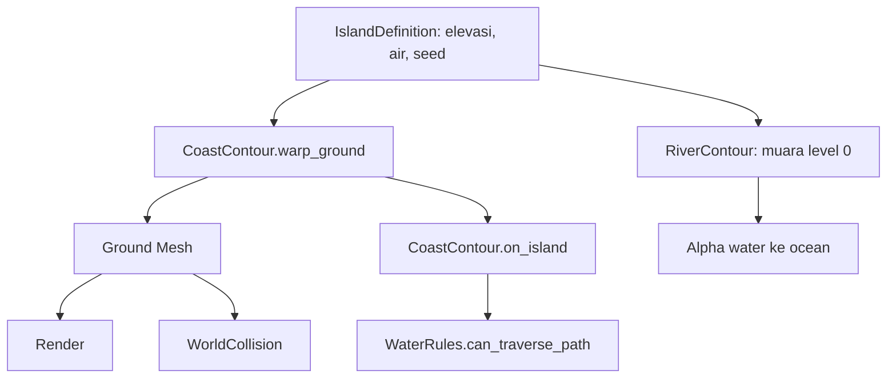

# Sprint 22 — audit garis pantai dan muara Nusantara

## Hasil konkret

Sprint 21 memiliki laut dekoratif tetapi geometri darat masih berakhir pada garis-garis persegi panjang. Sprint 22 mengubah posisi vertex ground level 0 dekat map boundary menurut medan deformasi world-space dua skala, kemudian menggunakan mesh yang sama untuk `WorldCollision`.

Pada fixture 16×10 grid, `tests/test_coast_contour.gd` mengukur rentang simpangan perimeter **0,930 unit dunia**; semua sampel tepat di kiri/kanan tepi sel tetap memiliki jarak berurutan kurang dari **0,006 unit**. Bentuknya kini lebih bervariasi daripada garis lurus, tanpa jitter acak setiap tile.

## Alur data

`CoastBuilder` memperlebar permukaan laut ke dalam batas peta hingga 1,55 unit (dibatasi untuk pulau kecil) untuk menutup lekukan yang masuk dan menopang blending muara. Gelombang pantainya masih didasarkan pada jarak perkiraan terhadap persegi panjang. Ini alasan gelombang paling depan belum sepenuhnya mengikuti setiap kelokan pantai.

Pada muara, `WaterSurface` mengkodekan vektor arus pada `COLOR.rg` dan transparansi per-vertex pada `COLOR.a`. Nilai alpha berubah dari **0,12 di garis map** menuju **1,00 pada jarak 1,35 unit**. Dengan laut di belakangnya, ujung sungai tidak lagi menunjukkan persegi biru seragam di luar pantai.

## Review visual

| Bukti gambar | Yang harus diamati | Status |
| --- | --- | --- |
| `s22_island_organic_coast.png` | Siluet pantai tidak lagi garis lurus menyeluruh, sungai tetap terhubung | Sudah berubah; masih berkerangka persegi |
| `s22_coastline_closeup.png` | Kurva panjang melintasi sel dengan shading rumput/pasir yang menyatu | Membaik; masih kurang variasi teluk besar dan pesisir batu |
| `s22_river_mouth.png` | Transisi air tawar ke laut tidak membentuk garis potongan biru keras | Alpha ramp ditambahkan; pencampuran visual masih sederhana |
| `s22_waterfall_closeup.png` | Tiga lembar tirai air saling menumpuk untuk menciptakan ketebalan fisik | Geometri lebih tebal; belum volumetrik secara render dan belum ada mist partikel |

## Batasan yang tersisa

1. **P0:** bentuk pulau bebas/teluk/tanjung berdasarkan mask yang bisa diedit dan disimpan, bukan sekadar deformasi batas rectangle.
2. **P0:** satu `signed distance field` bersama untuk ground, foam surf, ocean biome, physics, navigasi, dan batas editor; alur sekarang masih memiliki dua pendekatan visual.
3. **P0:** integrasi laut dengan gameplay renang dan momentum masuk/keluar muara.
4. **P1:** air terjun perlu geometri bervolume, fall-side cliff carving, busa pecah, butiran spray, serta pencocokan kamera referensi.
5. **P1:** material rumput/tebing memerlukan bentuk detail geometri (tufts, tonjolan sudut, retakan), bukan noise shader saja.

## Kejujuran sumber

Semua faktor deformasi, shader, palet, dan ambang traversability adalah hasil desain orisinal untuk prototipe game Nusantara. Tidak ada klaim bahwa rumus ini diperoleh dari hasil dekompilasi ACNH atau bahwa angka tersebut merupakan ukuran game Nintendo.
